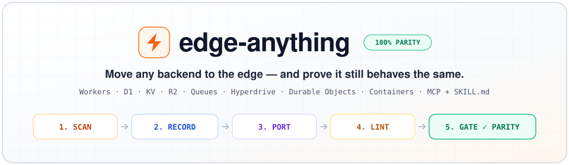
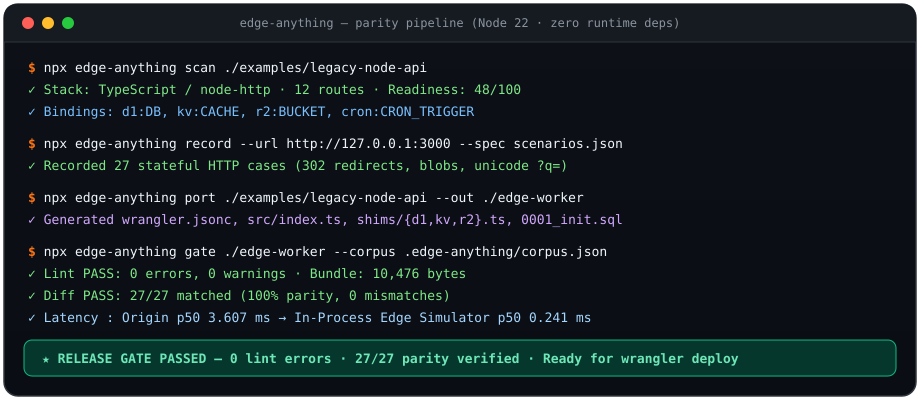
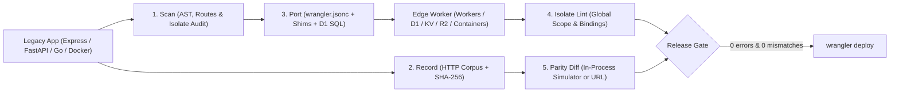

<div align="center">

<picture>
  <source media="(prefers-color-scheme: dark)" srcset="docs/assets/hero-dark.svg">
  <source media="(prefers-color-scheme: light)" srcset="docs/assets/hero-light.svg">
  
</picture>

<br><br>

<a href="https://github.com/ridloabelian/edge-anything/actions/workflows/ci.yml"></a>
<a href="./LICENSE"></a>
= 22.6">


<a href="https://github.com/ridloabelian/edge-anything"></a>

<br><br>

<a href="#why-edge-anything">Why edge-anything</a> ·
<a href="#5-stage-parity-loop">5-Stage Loop</a> ·
<a href="#before-vs-after-legacy-node--cloudflare-edge">Side-by-Side Port</a> ·
<a href="#measured-parity--performance">Benchmarks</a> ·
<a href="#quickstart">Quickstart</a> ·
<a href="#agent-native-integration-mcp--skillmd">AI Agents &amp; MCP</a> ·
<a href="#automatic-binding-matrix">Binding Matrix</a> ·
<a href="#faq--honest-boundaries">FAQ</a>

</div>

---

## Why `edge-anything`?

Migrating a real backend (`Express`, `Fastify`, `Node HTTP`, `Next.js`, `FastAPI`, `Flask`, `Go`, or `Dockerfile` services) to **Cloudflare Workers, D1, KV, R2, Queues, Hyperdrive, Durable Objects, and Containers** usually fails for three boring reasons: **silent V8 isolate incompatibilities** (`Date.now()` or `fetch()` in global scope), **stateful disk/SQLite assumptions**, and **subtle status/header/JSON drift** nobody catches until production.

**`edge-anything`** fixes this with a **zero-dependency TypeScript parity engine**: it records ground-truth HTTP traffic from your running legacy server, scaffolds an idiomatic edge Worker + shims, lints isolate constraints statically, and replays every recorded request through an in-process Cloudflare Edge Simulator (`node:sqlite`-backed D1, TTL-aware KV, R2, and Queues) until you hit **0 errors and 0 mismatches**.

<p align="center">
  
</p>

---

## 5-Stage Parity Loop

<table>
  <tr>
    <td width="20%" valign="top">
      <b>1. Scan</b><br><br>
      <code>edge-anything scan</code><br><br>
      Parses routes, SQL DDLs, dependencies, and V8 blockers to infer Cloudflare bindings and an edge readiness score.
    </td>
    <td width="20%" valign="top">
      <b>2. Record</b><br><br>
      <code>edge-anything record</code><br><br>
      Captures deterministic HTTP probes or ordered stateful scenarios (preserving <code>302</code>s &amp; binary blobs) with SHA-256 integrity.
    </td>
    <td width="20%" valign="top">
      <b>3. Port</b><br><br>
      <code>edge-anything port</code><br><br>
      Generates <code>wrangler.jsonc</code>, Web <code>fetch()</code> router stubs, <code>src/shims/*</code>, D1 SQL migrations, and <code>MIGRATION_PLAN.md</code>.
    </td>
    <td width="20%" valign="top">
      <b>4. Lint</b><br><br>
      <code>edge-anything lint</code><br><br>
      Catches missing exports, global-scope side effects, undeclared <code>env.*</code> bindings, and forbidden Node builtins.
    </td>
    <td width="20%" valign="top">
      <b>5. Diff &amp; Gate</b><br><br>
      <code>edge-anything gate</code><br><br>
      Replays every recorded case against your Worker simulator or live URL; exits <code>0</code> only at <b>100% parity</b>.
    </td>
  </tr>
</table>



---

## Before vs. After: Legacy Node → Cloudflare Edge

What `edge-anything` transforms in [`examples/legacy-node-api`](./examples/legacy-node-api) → [`examples/edge-worker-port`](./examples/edge-worker-port):

<table>
  <tr>
    <th width="50%">Legacy Backend (<code>server.ts</code> — Stateful Node)</th>
    <th width="50%">Ported Edge Worker (<code>src/index.ts</code> — Stateless Isolate)</th>
  </tr>
  <tr>
    <td valign="top">

```ts
// Sync local SQLite + in-memory Map + disk fs
const row = db
  .prepare('SELECT id, title, content FROM notes WHERE id = ?')
  .get(id);

const cached = ttlCache.get(`notes:${q}:${tag}`);

writeFileSync(path.join(blobStorageDir, key), data);
```

  </td>
    <td valign="top">

```ts
// Async D1 + Edge KV + Zero-Egress R2 + Queue
const row = await env.DB
  .prepare('SELECT id, title, content FROM notes WHERE id = ?')
  .bind(id)
  .first();

const cached = await env.CACHE.get(`notes:${q}:${tag}`, 'text');

await env.BUCKET.put(key, bytes, { httpMetadata: { contentType } });
```

  </td>
  </tr>
</table>

---

## Measured Parity & Performance

Measured locally comparing [`examples/legacy-node-api/server.ts`](./examples/legacy-node-api/server.ts) (Node HTTP + SQLite + TTL cache + local disk blobs + periodic interval) against [`examples/edge-worker-port/src/index.ts`](./examples/edge-worker-port/src/index.ts) (Cloudflare Worker + D1 + KV + R2 + Queues + Cron) via `npm run benchmark` (edge execution measured in the in-process Edge Simulator):

| Metric | Legacy Origin (`examples/legacy-node-api`) | Edge Worker Port (`examples/edge-worker-port`) |
| --- | ---: | ---: |
| **Routes Detected &amp; Ported** | 12 endpoints | **12 / 12 endpoints** |
| **Inferred Cloudflare Bindings** | `node:sqlite`, `ttlCache`, `fs` blobs, `setInterval` | **`DB` (D1), `CACHE` (KV), `BUCKET` (R2), Cron** |
| **Stateful Scenarios Replayed** | 27 HTTP cases (CRUD, `?q=` Unicode, cache bust, `302`, blobs, `400`/`404`/`409`) | **27 / 27 matched (100% parity, 0 mismatches)** |
| **Static Isolate Lint** | Pre-port readiness: `48 / 100` | **0 errors, 0 warnings** (`10,476` source bytes) |
| **p50 / p95 Execution Latency** | `3.607 ms` / `7.928 ms` *(local HTTP)* | **`0.241 ms` / `1.877 ms`** *(in-process simulator)* |

> [!TIP]
> Reproduce every metric on your own machine with **zero external services** or `npm install`:
> ```bash
> git clone https://github.com/ridloabelian/edge-anything.git && cd edge-anything
> npm test && npm run benchmark
> ```

---

## Quickstart

Requires **Node.js 22.6+** (tested on Node `22.23.5`, zero runtime or dev dependencies):

```bash
# 1. Inspect routes, SQL schemas, bindings & V8 isolate compatibility
npx edge-anything scan ./my-legacy-api --json

# 2. Record ground-truth HTTP corpus (or pass --cmd "node server.js" to auto-spawn)
npx edge-anything record --url http://127.0.0.1:3000 --dir ./my-legacy-api --out .edge-anything/corpus.json

# 3. Scaffold wrangler.jsonc, src/index.ts, typed env.d.ts, shims & D1 migrations
npx edge-anything port ./my-legacy-api --out ./my-edge-worker

# 4. Run static Cloudflare Workers V8 isolate lint checks
npx edge-anything lint ./my-edge-worker

# 5. Replay recorded corpus via in-process simulator (or --url http://127.0.0.1:8787 for wrangler dev)
npx edge-anything gate ./my-edge-worker --corpus .edge-anything/corpus.json --worker ./my-edge-worker/src/index.ts
```

> [!IMPORTANT]
> Dynamic fields like timestamps or request IDs won't trigger false parity failures: pass `--ignore-fields timestamp,requestId` (enabled by default). `edge-anything diff` still validates that masked keys **exist** and match the expected **runtime type**.

---

## Agent-Native Integration (MCP + `SKILL.md`)

`edge-anything` ships with first-class **Agent Skills** (`SKILL.md` + `.claude-plugin/plugin.json`) and a **Dual-Mode MCP Server** (`stdio` + Streamable HTTP) so coding agents run the full migration loop autonomously.

### Install Universal `SKILL.md`

```bash
# Install for Claude Code, OpenAI Codex, Google Antigravity, and Cursor at once
npx edge-anything skill install --agent all
```

### Connect via MCP (`stdio` or Streamable HTTP)

Add `edge-anything` to your agent's MCP config (`claude_desktop_config.json`, `.mcp.json`, Cursor, or Codex):

```json
{
  "mcpServers": {
    "edge-anything": {
      "command": "npx",
      "args": ["edge-anything", "mcp"]
    }
  }
}
```

Or mount `handleMcpHttpRequest` from `edge-anything/mcp` inside any Web `fetch()` handler.

<details>
<summary><b>View all 7 MCP Tools &amp; Capabilities</b></summary>

| Tool Name | Purpose | Key Inputs |
| --- | --- | --- |
| `edge_scan` | Inspect routes, SQL DDLs, inferred bindings &amp; V8 blockers | `dir` |
| `edge_port` | Scaffold `wrangler.jsonc`, shims, Worker router &amp; migrations | `sourceDir`, `outDir?`, `force?` |
| `edge_record` | Capture SHA-256 signed HTTP corpus from legacy origin | `originUrl`, `cmd?`, `sourceDir?`, `specPath?`, `outPath?` |
| `edge_lint` | Static V8 isolate lint against Worker code &amp; bindings | `dir` |
| `edge_diff` | Replay corpus against `--worker` simulator or live URL | `corpusPath`, `workerEntry?`, `targetUrl?`, `ignoreFields?` |
| `edge_gate` | Combined release gate (`0` lint errors &amp; `0` parity mismatches) | `targetDir`, `corpusPath`, `workerEntry?`, `targetUrl?` |
| `edge_binding_guide` | Return idiomatic code patterns &amp; gotchas per primitive | `kind` (`d1`, `hyperdrive`, `kv`, `r2`, `queues`, `durable_objects`, `containers`, `all`) |

</details>

---

## Automatic Binding Matrix

`edge-anything` inspects manifests (`package.json`, `requirements.txt`, `pyproject.toml`, `go.mod`, `Dockerfile`) and code patterns to recommend exact Cloudflare bindings (see full [`docs/binding-matrix.md`](./docs/binding-matrix.md)):

| Legacy Stack / Package / API | Cloudflare Primitive | Generated Binding | Strategy |
| --- | --- | --- | --- |
| `better-sqlite3`, `sqlite3`, `node:sqlite`, `aiosqlite` | **Cloudflare D1** | `env.DB` | `workers-native` + `migrations/0001_init.sql` |
| `pg`, `postgres`, `mysql2`, `prisma`, `drizzle-orm` | **Hyperdrive** | `env.HYPERDRIVE` | `workers-nodejs-compat` |
| `redis`, `ioredis`, `node-cache`, `lru-cache`, TTL `Map` | **Workers KV** | `env.CACHE` | `workers-native` + `EdgeKV` shim |
| `@aws-sdk/client-s3`, `minio`, `multer`, local `fs` blobs | **Cloudflare R2** | `env.BUCKET` | `workers-native` + `EdgeStorage` shim |
| `bullmq`, `bull`, `amqplib`, `celery` | **Cloudflare Queues** | `env.JOBS` | `workers-native` + `enqueueJob` |
| `ws`, `socket.io`, `yjs`, stateful room locks | **Durable Objects** | `env.STATE_DO` | `workers-native` |
| `node-cron`, `cron`, `setInterval` cleanup loops | **Cron Triggers** | `scheduled()` | `triggers.crons` |
| `openai`, `@anthropic-ai/sdk`, `@huggingface/inference` | **Workers AI** | `env.AI` | `workers-native` |
| `Dockerfile`, `child_process`, `sharp`, `puppeteer`, Go | **Cloudflare Containers** | `env.APP_CONTAINER` | `workers-hybrid-containers` |

<details>
<summary><b>View Static V8 Isolate Lint Rules (<code>ERR_*</code> &amp; <code>WARN_*</code>)</b></summary>

| Rule Code | Severity | What It Catches |
| --- | --- | --- |
| `ERR_MISSING_WRANGLER_CONFIG` | Error | Missing `wrangler.jsonc` / `wrangler.json` in target directory |
| `ERR_MISSING_ENTRY` | Error | Configured `main` entrypoint file does not exist |
| `ERR_MISSING_DEFAULT_EXPORT` | Error | Entrypoint lacks `export default { fetch(...) }` handler |
| `ERR_FORBIDDEN_NODE_BUILTIN` | Error | Disallowed runtime modules (`child_process`, `cluster`, `dgram`, `vm`, `worker_threads`, `tls`, `http2`) |
| `ERR_MISSING_NODEJS_COMPAT` | Error | `node:*` runtime imports used without `"nodejs_compat"` in `compatibility_flags` |
| `ERR_FORBIDDEN_FS_WRITE` | Error | Persistent disk writes (`writeFileSync`, `mkdirSync`, `rmSync`, etc.) inside Worker code |
| `ERR_UNDECLARED_BINDING` | Error | `env.BINDING` referenced in code without declaration in `wrangler.jsonc` |
| `ERR_GLOBAL_SCOPE_SIDE_EFFECT` | Error | Top-level `fetch()`, `Date.now()`, `Math.random()`, `crypto.randomUUID()`, or timers outside handlers |
| `WARN_MUTABLE_GLOBAL_STATE` | Warning | Module-level `let` or `new Map()` / `new Set()` that leak state across isolate requests |
| `WARN_BUNDLE_SIZE` | Warning | Total source footprint exceeding `900 KB` warning threshold |

</details>

---

## FAQ & Honest Boundaries

<details>
<summary><b>What can (and cannot) behavioral replay catch?</b></summary>

Behavioral replay proves equivalence across every HTTP scenario captured in `corpus.json` — including status codes, normalized `content-type` / `location` / CORS headers, deep structural JSON equality, and binary byte roundtrips. It **cannot** verify unexercised endpoints, cron side effects with no HTTP observable, or production-only distributed behaviors (such as global KV eventual consistency or real Postgres network latency behind Hyperdrive). Always pair the local simulator gate with targeted `--spec` scenarios and staging checks against `wrangler dev`. See [`docs/how-it-works.md`](./docs/how-it-works.md) for architecture details.

</details>

<details>
<summary><b>Why zero runtime dependencies?</b></summary>

`edge-anything` runs directly on Node.js 22+ built-ins (`node:sqlite`, `node:http`, `node:crypto`, `node:test`, native `fetch`, and native TypeScript type-stripping). Zero dependencies means instant `npx edge-anything` startup, zero supply-chain bloat, and zero build step to maintain.

</details>

---

## Documentation

* [`docs/how-it-works.md`](./docs/how-it-works.md) — Deep dive into the 5-stage verification pipeline and simulator internals
* [`docs/binding-matrix.md`](./docs/binding-matrix.md) — Legacy-to-Cloudflare primitive reference matrix
* [`skills/edge-anything/SKILL.md`](./skills/edge-anything/SKILL.md) — Universal coding-agent skill specification

## Star History

<a href="https://www.star-history.com/#ridloabelian/edge-anything&Date">
 <picture>
   <source media="(prefers-color-scheme: dark)" srcset="https://api.star-history.com/svg?repos=ridloabelian/edge-anything&type=Date&theme=dark" />
   <source media="(prefers-color-scheme: light)" srcset="https://api.star-history.com/svg?repos=ridloabelian/edge-anything&type=Date" />
   
 </picture>
</a>

---

> `edge-anything` is an independent open-source project and is not affiliated with, endorsed by, or sponsored by Cloudflare, Inc. "Cloudflare", "Cloudflare Workers", "D1", "R2", "Hyperdrive", and "Durable Objects" are trademarks of Cloudflare, Inc.

<p align="center">
  Made with ❤️ by <a href="https://github.com/ridloabelian">Ridlo Abelian</a> · <a href="./LICENSE">MIT License</a>
</p>
