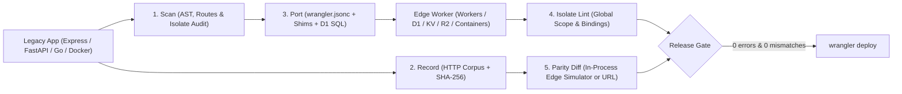

<h1 align="center">edge-anything</h1>

<p align="center"><b>Move any backend to the edge, and prove it still behaves the same.</b></p>

<p align="center">
  <a href="https://github.com/ridloabelian/edge-anything/actions/workflows/ci.yml"></a>
  <a href="./LICENSE"></a>
  
  
  
</p>

<p align="center">
  <a href="#5-stage-parity-pipeline">How It Works</a> ·
  <a href="#benchmark--parity-proof">Measured Parity</a> ·
  <a href="#quickstart">Quickstart</a> ·
  <a href="#agentic-integration-mcp--skills">MCP &amp; Agent Skills</a> ·
  <a href="./docs/binding-matrix.md">Binding Matrix</a>
</p>

---

**`edge-anything`** is a zero-dependency TypeScript engine for migrating legacy backends (`Express`, `Fastify`, `Node HTTP`, `Next.js`, `FastAPI`, `Flask`, `Go`, or `Dockerfile` services) onto **Cloudflare Workers, D1, KV, R2, Queues, Hyperdrive, Cron Triggers, Durable Objects, and Containers**—and proving with recorded HTTP replay that the edge port behaves identically to the original.

Instead of blindly rewriting code and hoping nothing broke, `edge-anything` records real HTTP request/response behavior from your existing server, generates the edge scaffold + shims, lints V8 isolate rules statically, and replays every recorded case through an in-process Cloudflare Edge Simulator (`node:sqlite`-backed D1, TTL-aware KV, R2, and Queues) or against `wrangler dev`.

---

## 5-Stage Parity Pipeline

<table>
  <tr>
    <td width="20%" valign="top">
      <b>1. Scan</b><br>
      <code>scan</code> inspects routes, SQL DDLs, dependencies, and V8 isolate blockers to infer exact Cloudflare bindings and a readiness score.
    </td>
    <td width="20%" valign="top">
      <b>2. Record</b><br>
      <code>record</code> executes deterministic probes or stateful scenarios against your legacy origin and saves a SHA-256 signed corpus.
    </td>
    <td width="20%" valign="top">
      <b>3. Port</b><br>
      <code>port</code> generates <code>wrangler.jsonc</code>, <code>src/index.ts</code>, typed <code>env.d.ts</code>, zero-dep shims, SQL migrations, and <code>MIGRATION_PLAN.md</code>.
    </td>
    <td width="20%" valign="top">
      <b>4. Lint</b><br>
      <code>lint</code> catches missing default exports, top-level <code>Date.now()</code>/<code>fetch()</code> side effects, undeclared <code>env.*</code> bindings, and forbidden builtins.
    </td>
    <td width="20%" valign="top">
      <b>5. Diff &amp; Gate</b><br>
      <code>gate</code> replays every recorded case against your Worker and exits <code>0</code> only at <b>0 lint errors</b> and <b>0 parity mismatches</b>.
    </td>
  </tr>
</table>



---

## Benchmark & Parity Proof

Measured locally on `examples/legacy-node-api` (Node HTTP + SQLite + TTL cache + local filesystem blob storage + periodic interval) ported to `examples/edge-worker-port` (Cloudflare Worker + D1 + KV + R2 + Queues + Cron) via `npm run benchmark` (edge execution measured in the in-process Edge Simulator):

| Metric | Legacy Origin (`examples/legacy-node-api`) | Edge Worker Port (`examples/edge-worker-port`) |
| --- | ---: | ---: |
| **Routes Detected & Ported** | 12 endpoints | **12/12 endpoints** |
| **Inferred Edge Bindings** | `node:sqlite`, `ttlCache`, `fs` blobs, `setInterval` | **`DB` (D1), `CACHE` (KV), `BUCKET` (R2), Cron** |
| **Recorded Stateful Scenarios** | 27 HTTP cases (CRUD, Unicode `?q=`, cache bust, `302`, blobs, `400`/`404`/`409`) | **27/27 matched (100% parity, 0 mismatches)** |
| **Isolate Lint Result** | Pre-port readiness: `48/100` | **0 errors, 0 warnings** (`10,476` source bytes) |
| **p50 / p95 Request Execution** | 3.607 ms / 7.928 ms (local HTTP) | **0.241 ms / 1.877 ms** (in-process simulator) |

Reproduce anytime with zero external services or `npm install`:

```bash
npm test
npm run benchmark
```

---

## Quickstart

Requires **Node.js 22.6+** (tested on Node `22.23.5`, zero runtime dependencies):

```bash
# 1. Inspect a legacy backend repository
npx edge-anything scan ./my-legacy-api --json

# 2. Record behavioral corpus from running legacy origin (or pass --cmd "node server.js")
npx edge-anything record --url http://127.0.0.1:3000 --dir ./my-legacy-api --out .edge-anything/corpus.json

# 3. Scaffold Cloudflare Workers project, shims, and D1 migrations
npx edge-anything port ./my-legacy-api --out ./my-edge-worker

# 4. Run static V8 isolate lint checks
npx edge-anything lint ./my-edge-worker

# 5. Replay recorded corpus against local Worker simulator (or --url http://127.0.0.1:8787)
npx edge-anything gate ./my-edge-worker --corpus .edge-anything/corpus.json --worker ./my-edge-worker/src/index.ts
```

---

## Agentic Integration (MCP + Agent Skills)

### Install Universal `SKILL.md`
Works with **Claude Code**, **OpenAI Codex**, **Google Antigravity**, and **Cursor**:

```bash
npx edge-anything skill install --agent all
```

### Connect via MCP (`stdio` or Streamable HTTP)
Add `edge-anything` to your coding agent's MCP configuration (`edge_scan`, `edge_port`, `edge_record`, `edge_lint`, `edge_diff`, `edge_gate`, `edge_binding_guide`):

```json
{
  "mcpServers": {
    "edge-anything": {
      "command": "npx",
      "args": ["edge-anything", "mcp"]
    }
  }
}
```

Or embed the Streamable HTTP handler directly using `handleMcpHttpRequest` from `edge-anything/mcp`.

---

## Automatic Binding Inference

`edge-anything` inspects manifests (`package.json`, `requirements.txt`, `pyproject.toml`, `go.mod`, `Dockerfile`) and code patterns to map legacy components to Cloudflare primitives (see [Binding Matrix](./docs/binding-matrix.md)):

* **SQLite (`better-sqlite3`, `sqlite3`, `node:sqlite`, `aiosqlite`)** → **D1** (`env.DB`) + `migrations/0001_init.sql`
* **Postgres / MySQL (`pg`, `postgres`, `mysql2`, `prisma`, `drizzle-orm`)** → **Hyperdrive** (`env.HYPERDRIVE`)
* **Redis / In-Memory Cache (`redis`, `ioredis`, `node-cache`, `lru-cache`)** → **Workers KV** (`env.CACHE`)
* **Object Storage / Disk Uploads (`@aws-sdk/client-s3`, `minio`, `multer`, `fs` blobs)** → **R2** (`env.BUCKET`)
* **Job Queues (`bullmq`, `bull`, `amqplib`, `celery`)** → **Cloudflare Queues** (`env.JOBS`)
* **WebSockets & Room State (`ws`, `socket.io`, `yjs`)** → **Durable Objects** (`env.STATE_DO`)
* **Scheduled Jobs (`node-cron`, `cron`, `setInterval`)** → **Cron Triggers** (`scheduled()`)
* **Native Binaries & `Dockerfile` (`child_process`, `sharp`, `puppeteer`, Go)** → **Cloudflare Containers** (`workers-hybrid-containers`)

---

## Documentation

* [How `edge-anything` Works](./docs/how-it-works.md)
* [Legacy-to-Cloudflare Binding Matrix](./docs/binding-matrix.md)
* [Universal Agent Skill (`SKILL.md`)](./skills/edge-anything/SKILL.md)

---

> `edge-anything` is an independent open-source project and is not affiliated with, endorsed by, or sponsored by Cloudflare, Inc. "Cloudflare", "Cloudflare Workers", "D1", "R2", "Hyperdrive", and "Durable Objects" are trademarks of Cloudflare, Inc.

## License

[MIT](./LICENSE) © 2026 Ridlo Abelian
